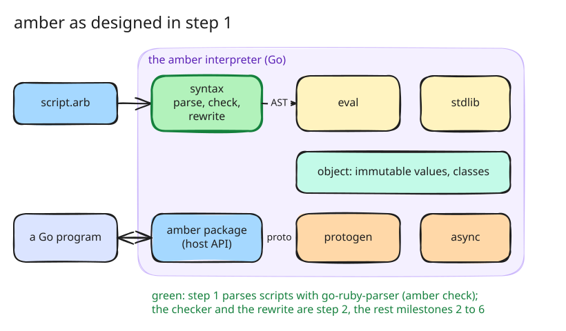

# 1. The language design, and `amber check`

The first step writes down what amber is and builds the one command that can
exist before an interpreter: `amber check`, which parses a script. Everything
after it is held to the design and to the example scripts this step adds.

## What amber is for

A Go program wants to run scripts that its users write, without giving
them a way to break it. Those scripts should look like Ruby, which is easy
to read and write, but they should not be able to do what makes an embedded
Ruby hard to host: change shared objects from two threads, reopen a class
the host relies on, monkey-patch the standard library, reach the file
system. And the values a script produces should cross into Go, into another
goroutine and onto the wire without a conversion layer written by hand.

From that, the design takes four decisions that shape everything else:

- **Every value is immutable.** `a = 1; a = 2` rebinds a name; nothing
  changes an object. A copy with changes is a method call: in this design
  `point.tap { |p| { x: p.x + 1 } }`, and `a.x.y = 3` is sugar for nested
  copies that rebinds `a`. With no mutable state, there is nothing for two
  goroutines to race on.
- **Every object is a protobuf message.** A class declares typed fields
  (`int :x, :y`), and the interpreter builds a protobuf descriptor from
  them, so an instance is a [`dynamicpb`](https://pkg.go.dev/google.golang.org/protobuf/types/dynamicpb)
  message that a Go host can marshal, inspect or hand over a wire.
- **Concurrency is `async` and `await`.** `async worker, :run, item` copies
  the receiver and the arguments through protobuf and runs the call on its
  own goroutine; `await` returns its result or re-raises its exception. A
  process shares nothing with the script that started it, much like an
  [Erlang process](https://www.erlang.org/doc/system/ref_man_processes.html).
- **Classes are values and cannot be reopened.** `class X … end` binds `X`
  to a class identified by its body. Loading the same file twice gives the
  same class; a different body rebinds the name and leaves the old class and
  its instances alone.

amber adds no syntax. Every script parses as Ruby, so the front end is an
existing parser, [go-ruby-parser](https://github.com/go-ruby-parser/parser),
which is pure Go: no cgo and no Ruby installation. amber gives some of what
it parses a different meaning, and rejects the rest by name.

## What the step adds

- [doc/design/amber.md](../design/amber.md): the language, what it keeps
  from Ruby and what it leaves out, the value table, classes, modules,
  blocks, async, protobuf, the Go host API and a Ruby adapter, and seven
  milestones to build it in.
- `amber check script.arb`, which parses a script and reports the parser's
  error with its line: [src/cmd/amber/main.go:51](https://github.com/radiospiel/amber/blob/@@COMMIT@@/src/cmd/amber/main.go#L51-L60).
  Running a script fails with a pointer to `check`, since there is no
  evaluator yet.
- The example corpus under `examples/`: each `<name>.arb` beside the output
  it must produce in `<name>.expected`. The corpus is the specification.
  At this step a test only proves every example parses
  ([src/cmd/amber/examples_test.go:19](https://github.com/radiospiel/amber/blob/@@COMMIT@@/src/cmd/amber/examples_test.go#L19)); later
  steps run the scripts and compare their output.
  [examples/point.arb](../../examples/point.arb) shows a class, a copy with
  `tap` and the `a.x = 100` rewrite.

## Decisions, and the questions behind them

The first draft left four questions open. They were decided before any
interpreter code was written, and the design records them under *Decisions
taken* ([doc/design/amber.md:407](https://github.com/radiospiel/amber/blob/@@COMMIT@@/doc/design/amber.md#L407)):

- **Overriding.** A child class may define a method its parent defines, and
  dispatch is dynamic. One definition per hierarchy with static dispatch
  would have been simpler to implement and is too far from Ruby.
- **Modules** are namespaces and mixins from the first release. Mixins bring
  a method resolution order, which inheritance needs anyway.
- **Symbols** have no protobuf type. A class that stores one declares an
  `enum` field with the symbols it accepts; everywhere else a symbol becomes
  a string at the protobuf boundary.
- **Hash keys** that cross into protobuf are the four kinds protobuf's
  `map<,>` allows: string, symbol (as a string), integer and boolean.

A fifth came from reading the protobuf side closely. Field numbers follow
declaration order, so deleting a field renumbers every field after it and
breaks every host that compiled the old schema. A class body takes
`reserved <number> [, :name]`, as a `.proto` file does
([protobuf: reserved fields](https://protobuf.dev/programming-guides/proto3/#reserved)),
and fields after it skip the reserved number. See
[examples/proto.arb](../../examples/proto.arb).

One more decision belongs here although ark took it later: lists and
hashes are Ruby's `Array` and `Hash`, in the value table and in every
message a script sees. ark called them `List` and `Map` until its own
benchmark work showed that every Ruby error message and `inspect` reads
differently with those names (step 14 is where ark
changed it).

## What this repository adds

amber was built in [radiospiel/ark](https://github.com/radiospiel/ark), and
this repository keeps ark's code with three changes that every step carries:
the module is `github.com/radiospiel/amber`, the command lives in
`src/cmd/amber` from the start, and it answers `amber version` and
`amber --version`, which the integration tests in `tests/integration/`
check.
