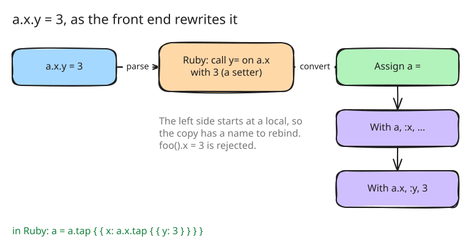

# 2. The front end: amber's tree, the checker and the rewrite

go-ruby-parser returns Ruby's syntax tree. That tree says nothing about what
amber leaves out, and it spells `a.x.y = 3` as a call to a setter `y=`,
which amber does not have. Step 2 puts amber's own front end between the
parser and everything after it: the `syntax` package converts Ruby's tree
into amber's, rejects what the language leaves out, and rewrites
assignments into copies.

## amber's own tree

`syntax.Parse` ([src/syntax/syntax.go:47](https://github.com/radiospiel/amber/blob/c4af3b344d35e822bc74bebd58743e15c7a118c7/src/syntax/syntax.go#L47)) parses the
source and converts it, node by node, into the types in
[src/syntax/node.go](../../src/syntax/node.go). amber's tree is smaller than
Ruby's: there is one `Call` for every way Ruby spells a method call, and
`async`, `await` and the class-body declarations (`int :x`, `reserved`,
`include`) are nodes of their own, so the evaluator does not have to
recognise them among method calls. A later step can change the parser
without touching the evaluator.

## The checker

The conversion is also the checker. A construct amber leaves out is
rejected while it is converted, with its line and a reason that says what
to write instead. The reasons are in
[src/syntax/convert.go](../../src/syntax/convert.go); a few of them:

| Script | Message |
|---|---|
| `def x=(v)` | `def x=: setters are not supported; a field changes through tap` |
| `list << 1` | `<< mutates its receiver: amber values are immutable; use + or append` |
| `name.upcase!` | `upcase!: bang methods mutate their receiver, and amber values are immutable` |
| `$count` | `global variables are not supported` |
| `@@count` | `class variables are not supported` |
| `for x in xs` | `for loops are not supported: use each` |
| `class << self` | `class << self is not supported: define class methods with def self.name` |
| `/a+/` | `regular expressions are not supported` |

`amber check` reports every error, not only the first: the converter
collects them and keeps going ([src/syntax/convert.go:36](https://github.com/radiospiel/amber/blob/c4af3b344d35e822bc74bebd58743e15c7a118c7/src/syntax/convert.go#L36)).
Several of these rejections are lifted in later steps, once the benchmarks
show what scripts need: `for` and regular expressions among them.

## The rewrite

`a.x.y = 3` cannot change `a.x`, since nothing changes. It means: a copy of
`a` whose `x` is a copy of `a.x` whose `y` is 3, bound to `a` again. The
converter builds that from the inside out
([src/syntax/convert.go:750](https://github.com/radiospiel/amber/blob/c4af3b344d35e822bc74bebd58743e15c7a118c7/src/syntax/convert.go#L750-L774)): each link of
the chain becomes a `With` node, a copy of its target with one key
replaced, and the outermost becomes an assignment to the variable the chain
starts at. Index assignment, `h[:k] = v` and `list[0] = v`, takes the same
path with the index as the key.

The chain has to start at a local variable, or at an instance variable
inside `initialize`, so that the copy has a name to go to. `foo().x = 3` is
rejected: the copy would be thrown away, which is never what the script
meant.

## One class per body

A class is a value identified by its body (see step 1). The converter
hashes each class and module body into a digest
([src/syntax/syntax.go:70](https://github.com/radiospiel/amber/blob/c4af3b344d35e822bc74bebd58743e15c7a118c7/src/syntax/syntax.go#L70)), over the tree with line
numbers left out, so the same definition in two files, or loaded twice, is
one class, and a changed body is another.

## Tests

[src/syntax/syntax_test.go](../../src/syntax/syntax_test.go) holds the
checker to its messages and the rewrite to its shape, and every script in
`examples/` passes the checker.
