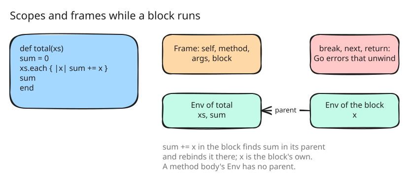

# 3. The evaluator core and the scalar library

After step 2, amber could check a script and not run it. Step 3 makes
`amber script.arb` run scripts without classes of their own: literals,
variables, operators, control flow, methods, blocks, lambdas, exceptions
and pattern matching, over the scalar half of the standard library.

## Values

The `object` package holds the values. In this step a value is a Go
interface with one method, the class it dispatches on
([src/object/value.go:14](https://github.com/radiospiel/amber/blob/71536c3179f99105438d13ddc157a3e2f7bd1661/src/object/value.go#L14-L16)), and each kind is a
Go type: `Int` is an `int64`, `String` a Go string, an `Array` a struct
around a slice nobody changes after it is built. A hash is ordered, as
Ruby's is, and keyed by structure: two arrays with equal elements are the
same key. Nothing in the package has a method that changes a value, so
sharing one between scopes, and later between goroutines, needs no copy.

The interface is the simplest representation to write and the slowest to
run: every integer a script computes is boxed onto the heap. Steps 9, 11
and 12 measure that cost and remove it.

## The evaluator

The `eval` package walks the tree. `eval` is one type switch over the
node kinds ([src/eval/eval.go:25](https://github.com/radiospiel/amber/blob/71536c3179f99105438d13ddc157a3e2f7bd1661/src/eval/eval.go#L25)), a design
that is easy to extend and that step 10 replaces with compiled closures
once there are benchmarks to say so.

Two structures carry the state of a running script:

- An `Env` is a lexical scope of local variables. A block's scope has the
  scope it was written in as its parent, so `sum += x` inside a block
  rebinds the `sum` of the method around it, as in Ruby
  ([src/eval/env.go:33](https://github.com/radiospiel/amber/blob/71536c3179f99105438d13ddc157a3e2f7bd1661/src/eval/env.go#L33-L41)). A method body starts a
  scope with no parent.
- A `Frame` is a method activation: `self`, the method, its arguments and
  block, and the class that defines it, where `super` continues.

`break`, `next`, `return` and `retry` leave the code they are in by
travelling up the evaluator as Go errors
([src/eval/control.go:12](https://github.com/radiospiel/amber/blob/71536c3179f99105438d13ddc157a3e2f7bd1661/src/eval/control.go#L12-L17)), each with the frame or
block it is bound for. An exception travels the same way as an
`*object.Exception`, which `rescue` catches by class. Go's own call stack is
the script's call stack.

Two interpreters in one process do not see each other's definitions:
top-level methods and constants belong to the interpreter, not to the
builtin classes every interpreter shares. That matters in step 7, when each
`async` process gets an interpreter of its own.

## The library

The `stdlib` package defines the builtin methods in Go: Kernel (`puts`,
`print`, `p`, `warn`, `raise`, `format`, `loop`, the conversions), Object,
Comparable, Integer, Float, String, Symbol, `nil`, the booleans and the
exception classes, with `inspect` and `to_s` written to print what Ruby
prints. Arrays and hashes get what the examples need; step 4 completes
them.

The `amber` package is now the host API's first function,
`amber.Run` ([src/amber/amber.go:16](https://github.com/radiospiel/amber/blob/71536c3179f99105438d13ddc157a3e2f7bd1661/src/amber/amber.go#L16-L26)), and the binary
reports an uncaught exception as `script:line: message (Class)`, as Ruby
does.

## Held to Ruby

Four new examples (`control`, `methods`, `patterns`, `strings`) are plain
Ruby, and their expected output is what `ruby` prints for them, so amber
is held to Ruby's behaviour wherever the two languages overlap. The
examples test runs every script and compares its output. An example that
needs a later step stays listed as pending and must keep failing until that
step lands ([src/cmd/amber/examples_test.go:20](https://github.com/radiospiel/amber/blob/71536c3179f99105438d13ddc157a3e2f7bd1661/src/cmd/amber/examples_test.go#L20)), so the
list of what is missing is never out of date.
