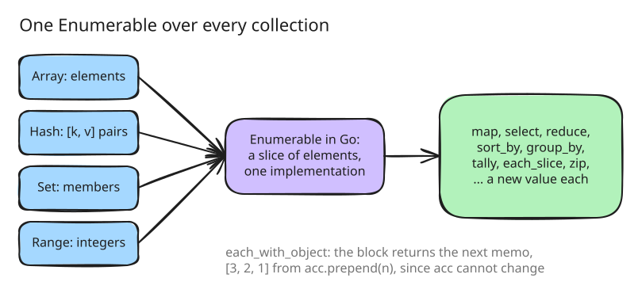

# 4. The collection library

Step 3 gave arrays, hashes, sets and ranges their size, indexing and `each`.
Step 4 completes them, and with them the part of Ruby that most scripts are
made of: `map`, `select`, `reduce`, `sort_by`, `group_by` and the rest of
`Enumerable`.

## One Enumerable

Ruby's `Enumerable` is a module whose methods are written in terms of
`each`. amber's is one Go implementation over the elements of whatever
includes it: an array's elements, a set's members, a range's integers, a
hash's `[key, value]` pairs ([src/stdlib/enumerable.go:12](https://github.com/radiospiel/amber/blob/b2dc615825a51f30127139e3fbf14b4333d50a17/src/stdlib/enumerable.go#L12-L31)).
Every method collects the receiver's elements into a Go slice and works on
that, so it is written once and holds for all four classes.

The price is that the elements exist all at once. `(1..1_000_000).each`
builds a million-element array before it yields the first, which shows in
the history benchmark that sums a range with a block: 1.37 s at this step,
against 0.21 s for MRI. Lazy enumerators, which produce elements on
demand, arrive with step 26; at this step a method called without a block returns
an array instead of an enumerator.

## Ruby's methods, without mutation

Each class adds its own methods, and every one of them returns a new value.
Where Ruby's method mutates, amber offers a name that says it returns a
copy:

| Ruby | amber |
|---|---|
| `list << x`, `list.push(x)` | `list.append(x)`, `list + [x]` |
| `list.unshift(x)` | `list.prepend(x)` |
| `list.delete(x)` | `list.without(x)` |
| `h[k] = v` on a value | `h.put(k, v)` (and `h[k] = v` rebinds a local, see step 2) |
| `h.delete(k)` | `h.without(k)`, `h.except(k)` |
| `set << x` | `set.add(x)` |

Ruby has `append` and `prepend` too, as aliases of `push` and `unshift`
that change the array; amber's return a copy and leave the receiver alone.
[examples/immutable.arb](../../examples/immutable.arb) shows each of them,
and that the receiver is unchanged afterwards.

`each_with_object` is where immutability shows most. Ruby's passes one
object to every iteration and expects the block to change it. In amber the
object cannot change, so the memo the next iteration sees is what the block
returns ([src/stdlib/enumerable.go:39](https://github.com/radiospiel/amber/blob/b2dc615825a51f30127139e3fbf14b4333d50a17/src/stdlib/enumerable.go#L39)):
`list.each_with_object([]) { |n, acc| acc.prepend(n) }` reverses a list.
It is `reduce` with Ruby's argument order.

## Held to Ruby

[examples/collections.arb](../../examples/collections.arb) is plain Ruby,
134 lines over the four classes, and its expected output is what ruby 3.3
prints; amber matches it exactly. The sorts amber needs are Go's, with
`<=>` dispatched for each comparison ([src/stdlib/enumerable.go:705](https://github.com/radiospiel/amber/blob/b2dc615825a51f30127139e3fbf14b4333d50a17/src/stdlib/enumerable.go#L705-L736)),
which is correct for every value and slow for integers; step 35 adds a
path for arrays that hold only integers.
