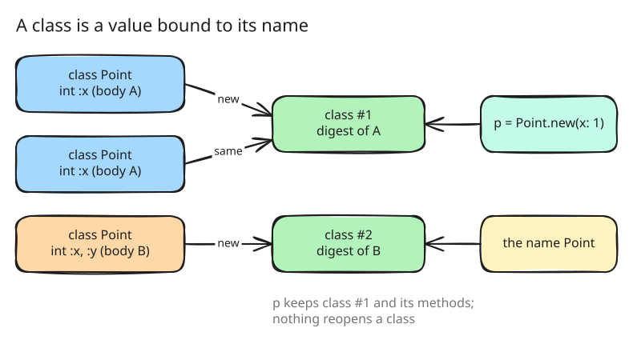

# 5. Classes with typed fields, copies through `tap`, and modules

Until this step a class could define methods and nothing else. Step 5 gives
classes what the design is built around: typed fields, an `initialize` that
is the only place a field is set, copies with changes, inheritance of
fields, and modules as mixins.

## Typed fields

A class body declares its fields with helpers named after their protobuf
types: `string`, `int`, `float`, `bool`, `bytes`, `list :name, of:`,
`map :name, key:, value:`, `set :name, of:`, `ref :name, Class` and
`enum :name, values: [...]`
([src/eval/fields.go:12](https://github.com/radiospiel/amber/blob/@@COMMIT@@/src/eval/fields.go#L12)). Each
field takes the lowest number that no field and no `reserved` statement
holds, keeps its default, and gets a reader.

Every value stored into a field is checked against its type
([src/eval/fields.go:150](https://github.com/radiospiel/amber/blob/@@COMMIT@@/src/eval/fields.go#L150)). Where protobuf
would convert, amber converts: an Integer stored into a `float` field
becomes a Float, a symbol key in a string-keyed map becomes a string, an
`enum` field takes only its declared symbols. Anything else is a
`TypeError` that names the field, so a wrong value is caught where it is
stored rather than where it is read:

```
TypeError: field age of Person takes an int, not an instance of String
```

`initialize` fills the instance it builds; a class without one takes its
fields as keywords, `Address.new(street: "Main 1", zip: 12345)`.
[examples/fields.arb](../../examples/fields.arb) covers every field type,
the type errors and keyword construction.

## Copies

`tap` with a block that returns a hash is the copy with changes:
`point.tap { |p| { x: p.x + 10 } }` returns a new instance with `x`
replaced ([src/eval/fields.go:424](https://github.com/radiospiel/amber/blob/@@COMMIT@@/src/eval/fields.go#L424-L448)). Each key
goes through `with`, which copies the fields of an instance, a hash or an
array and replaces one ([src/eval/fields.go:375](https://github.com/radiospiel/amber/blob/@@COMMIT@@/src/eval/fields.go#L375-L420)).
The `With` nodes the front end builds from `a.x.y = 3` (step 2) call the
same function one link at a time, so the sugar and the explicit copy are
one mechanism.

Using `tap` for this follows the original request, and is the one decision
of this step that did not last: Ruby's `tap` yields its receiver and
returns it unchanged, an idiom scripts rely on, and step 31 moves the copy
to `with`, the name Ruby's `Data` uses, and gives `tap` its Ruby meaning
back.

## A class is a value

Defining a class evaluates its body into a class identified by the body's
digest (step 2), and binds the name to it
([src/eval/classes.go:134](https://github.com/radiospiel/amber/blob/@@COMMIT@@/src/eval/classes.go#L134-L169)). The same
body again is the same class. A different body is a new class: the name now
means it, and every instance made earlier keeps its own class and methods.
Redefining a builtin class is an error.



A subclass starts from its parent's fields with their numbers
([src/eval/fields.go:452](https://github.com/radiospiel/amber/blob/@@COMMIT@@/src/eval/fields.go#L452)), so its
message extends the parent's. `include` and `extend` add a module's
methods with Ruby's method resolution order, and a field's reader cannot be
redefined, since a method that hid a field would make the message and the
object disagree.

The `point`, `nested_assignment`, `redefinition`, `inheritance` and
`modules` examples, written in step 1, leave the pending list and pass.
