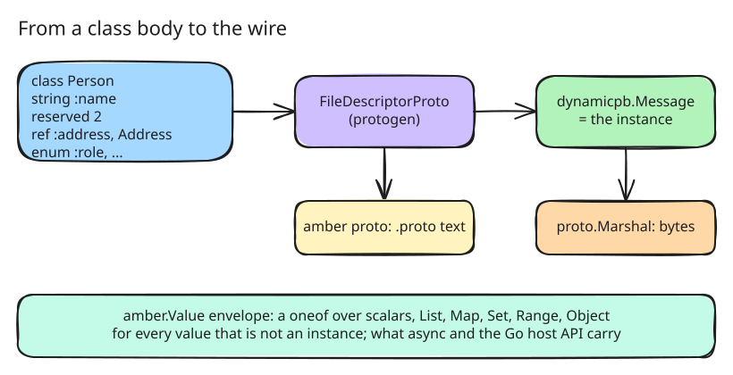

# 6. Every class is a protobuf message; the host API

After step 5 an instance was a class and a slice of fields. The design
promises more: an instance *is* a protobuf message, which a Go program can
marshal, inspect and hand over a wire without amber code in between. Step 6
keeps that promise, and gives Go programs an API to load scripts and call
into them.

## From fields to a descriptor

The `protogen` package builds one protobuf file descriptor per class from
its field declarations ([src/protogen/descriptor.go:121](https://github.com/radiospiel/amber/blob/@@COMMIT@@/src/protogen/descriptor.go#L121-L171)):

- scalars are proto3 `optional`, so an unset field reads back as `nil`;
- `list` and `set` are `repeated`, `map` a protobuf `map<,>`;
- each `enum` field gets a nested enum with an `_UNSPECIFIED` zero value
  that stands for `nil`, and its symbols upper-cased after it;
- `reserved` numbers and names become `reserved` statements;
- a `ref` to a class in another module imports that module's file.

Messages are instantiated as [`dynamicpb`](https://pkg.go.dev/google.golang.org/protobuf/types/dynamicpb)
messages over that descriptor, so `proto.Marshal` of an instance is the wire
form of its class.



`amber proto script.arb` prints the `.proto` files of a script's classes,
one per package. For [examples/proto.arb](../../examples/proto.arb):

```proto
message Person {
  enum Role {
    ROLE_UNSPECIFIED = 0;
    ROLE_ADMIN = 1;
    ROLE_USER = 2;
  }
  reserved 2;
  reserved "nickname";
  optional string name = 1;
  optional Address address = 3;
  repeated string emails = 4;
  map<string, int64> scores = 5;
  optional Role role = 6;
}
```

A host that compiles that file with `protoc` gets Go types whose wire form
matches what the interpreter produces.

## The envelope

Values that are not instances, an array, a hash, a range, a scalar,
travel in `amber.Value`, a message with a `oneof` over the scalar kinds and
`List`, `Map`, `Set`, `Range` and `Object`
([src/protogen/envelope.go:16](https://github.com/radiospiel/amber/blob/@@COMMIT@@/src/protogen/envelope.go#L16-L33)). The envelope's
message names keep protobuf's vocabulary, which is why they are `List` and
`Map` and not Ruby's names. A symbol travels as a string. The envelope is
what step 7's `async` serialises, and what the host API takes and returns.

In a script, `Person.proto`, `to_proto`, `from_proto`, `to_value_proto`
and `from_value_proto` expose all of this.
[examples/roundtrip.arb](../../examples/roundtrip.arb) builds an instance
with every field type, marshals it and reads it back equal.

## What the wire form changed

The wire form has no order for a `map<,>` and no absent repeated field.
For a value to survive `from_proto(to_proto(v)) == v`, two things changed
in the value model: a hash's identity no longer depends on insertion order,
so a decoded hash, which comes back sorted by key, is equal to the one that
was encoded; and a `list`, `set` or `map` field given `nil` holds the empty
collection, as it reads back.

Binary data is a `Bytes` value at this step, the value of a `bytes` field,
printed as `"\x00\x01".b`. Step 30 replaces it with a String whose encoding
is binary, as in Ruby.

## The host API

The `amber` package loads a script and calls into it
([src/amber/amber.go:83](https://github.com/radiospiel/amber/blob/@@COMMIT@@/src/amber/amber.go#L83-L119)):

```go
prog, err := amber.Load("script.arb", src, os.Stdout, os.Stderr)
err = prog.Run()                                          // defines the classes
out, err := prog.Call("Point", "new", map[string]any{"x": 1, "y": 2})
msg := out.(proto.Message)                                // a dynamicpb message
sum, err := prog.Call(msg, "+", msg)                      // a method on an instance
text, err := prog.Proto("Point")                          // the .proto text
```

A `nil` receiver reaches the script's top-level methods, a class name a
class method, and a `proto.Message` of a loaded class an instance. Go
values convert by the value table in the design; results come back as Go
values and `proto.Message`s.
