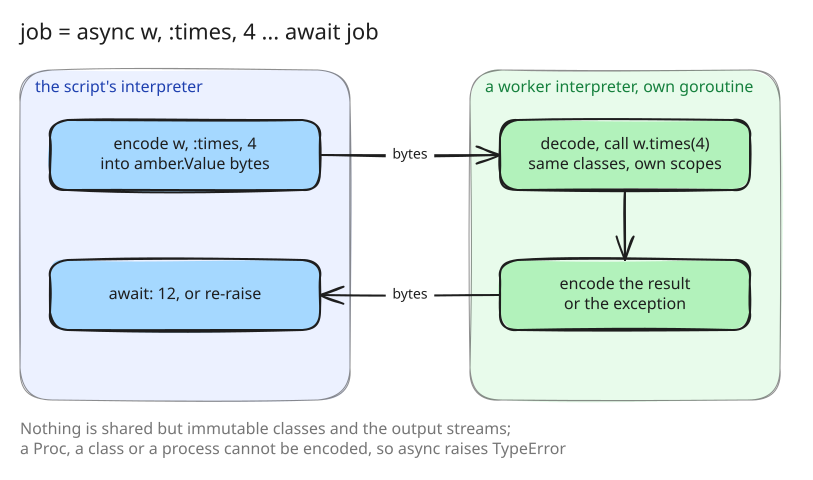

# 7. `async` and `await`

Until this step `async` and `await` failed as not implemented. Step 7 makes
them work: `async recv, :method, *args` runs the call on a process of its
own, and `await` collects its result or re-raises its exception.

## A process is an interpreter on a goroutine

A process is a goroutine running a worker interpreter
([src/eval/async.go:230](https://github.com/radiospiel/amber/blob/@@COMMIT@@/src/eval/async.go#L230-L252)). The
worker writes to the same output streams and sees the same classes,
through a snapshot of the constants, since a class is immutable once it is
bound. Everything else is its own: its scopes, its top-level `self`, and
its copies of the receiver and the arguments.

Those copies are made the way step 6 makes any value travel. At the call
site the receiver, the method name and the arguments are encoded into the
`amber.Value` envelope, and the worker decodes them on its side
([src/eval/async.go:165](https://github.com/radiospiel/amber/blob/@@COMMIT@@/src/eval/async.go#L165-L225)). A value that cannot
be encoded, a Proc, a class or a process, fails at the `async` call with a
`TypeError`, where the script can see it, not inside the job. The result
travels back the same way, and a result that cannot be encoded raises in
the process.

This is the payoff of immutability. The two interpreters share only values
that nothing can change, so there is no lock in the evaluator and nothing
for two goroutines to race on; `go test -race` runs the examples clean.

## Awaiting

`await job` blocks until the process finishes. `await recv, :method, *args`
is `async` and `await` in one step. `await :all` waits for every process
the current method started, its blocks included, that nobody has awaited
yet, returns their results in start order, and raises the first failure
only after all of them have finished
([src/eval/async.go:125](https://github.com/radiospiel/amber/blob/@@COMMIT@@/src/eval/async.go#L125-L150)).

A process is a value, so a method may return one and its caller await it.
The run ends when every process has, and the failure of a process that
nobody awaited goes to standard error rather than vanishing.
[examples/processes.arb](../../examples/processes.arb) covers scopes,
keyword arguments, nesting, failures and what a process may carry.

## What it buys, measured

Four calls of a recursive `fib(24)`, one after the other and as four
processes ([07-par_seq.arb](07-par_seq.arb) and [07-par_async.arb](07-par_async.arb)),
on the binary of this step, on four cores:

| GOGC | in sequence | four processes |
|---|---|---|
| 100, Go's default | 1.75 s | 1.35 s |
| 400 | 1.79 s | 0.96 s |
| off | 1.81 s | 0.85 s |

The processes run in parallel, and Go's collector holds them back: every
integer the evaluator computes is a heap allocation (step 3), so four
goroutines allocating at full speed keep the collector busy, and with the
default setting the four processes take three quarters of the time one
after another does. Making the evaluator allocate less, in steps 9 to 12,
and running the collector less often, in step 33, are what let `async` use
the cores it is given.
