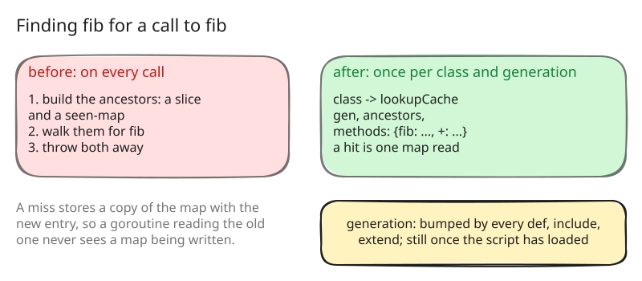

# 8. A method cache per class

With step 7 the design was complete, and the first question about it was
speed. A recursive Fibonacci in amber and in CRuby, side by side, showed
amber an order of magnitude behind, and a CPU profile of amber showed where
a third of the time went: not into the arithmetic, but into finding the
method `fib` before each call.

## The history benchmarks

From this step on, the documents measure. [benchmarks/](benchmarks) holds
six scripts, each stressing one thing, and `run.rb`, which times them; the
README there says what each one does. The numbers below are best-of-three
wall times on the binaries of this repository's steps, on one machine with
four cores, with other work running beside them, so they compare steps with
each other and not with other machines. MRI is ruby 3.3.6.

For the evaluator as steps 3 to 6 left it:

| | fib | loop | block | strings |
|---|---|---|---|---|
| MRI | 0.12 s | 0.27 s | 0.21 s | 0.20 s |
| step 3 | 1.62 s | 11.4 s | 1.43 s | 1.17 s |
| step 6 | 1.82 s | 11.1 s | 1.52 s | 1.43 s |

## Where the time went

Every call looked up its method with `Lookup`, which walked the class's
ancestors, and the ancestors were computed on each call: a fresh slice and
a fresh seen-map for the modules, built and thrown away. Ruby's method
resolution order is the same for every call to the same class, so there was
nothing to compute more than once.

## The cache

Each class keeps a lookup cache: its ancestors and the methods it has
resolved so far by name, under a generation
([src/object/class.go:45](https://github.com/radiospiel/amber/blob/4ac086c827c3c26924fa3ffc3694f20d7f9f0603/src/object/class.go#L45),
[src/object/class.go:60](https://github.com/radiospiel/amber/blob/4ac086c827c3c26924fa3ffc3694f20d7f9f0603/src/object/class.go#L60-L68)). Every
change to any class's methods or ancestry bumps the generation, so a cache
from before the change is rebuilt on its next use. A class changes only
while its body is evaluated, so once a script has loaded the generation
stands still and each name is resolved once per class.

The cache is read by every process of step 7 at once. It is never modified
after it is stored: a miss stores a copy with the new entry
([src/object/class.go:209](https://github.com/radiospiel/amber/blob/4ac086c827c3c26924fa3ffc3694f20d7f9f0603/src/object/class.go#L209-L226)),
so a goroutine holding the old one never sees a map being written, and
there is no lock on the hot path.

Writes to a class's methods go through four functions, `SetMethod`,
`SetSingletonMethod`, `Include` and `Extend`, the only writers, which is
what keeps the caches honest; a test checks that a method defined after a
miss is found.

## What it bought

Measured in-process through the `amber` package, `fib(27)`:

| | time | allocations |
|---|---|---|
| step 7 | 2.04 s | 12.7 M |
| step 8 | 1.07 s | 4.8 M |

Half the time and two thirds of the allocations were the lookup. The rest
of the allocations are the subject of the next step.
