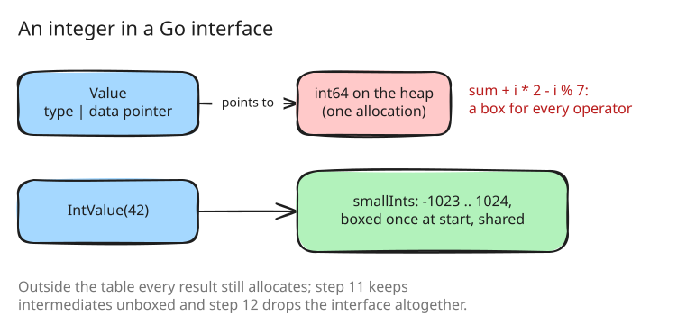

# 9. Two allocations per method call instead of seven

After step 8 the profile of `fib` no longer showed one hot spot; it showed
the garbage collector. Each method call allocated seven times: the argument
slice, the frame, the scope, the scope's variable map, and a heap box for
every integer it computed. Step 9 removes five of them.

## Operators on numbers skip dispatch

`n - 1` was a method call like any other: evaluate the arguments into a
slice, look up `-` on Integer, call it. But Integer and Float cannot be
reopened and no method of theirs can be replaced, so `-` on two integers
can only mean integer subtraction. The evaluator now checks for two
integers or two floats before it builds anything, and computes the result
directly ([src/eval/call.go:63](https://github.com/radiospiel/amber/blob/@@COMMIT@@/src/eval/call.go#L63)). Every other receiver goes
through dispatch as before, so the semantics do not change.

## A scope without a map

A scope kept its variables in a Go map, allocated with the scope. Most
scopes hold a handful of variables, so a scope now holds its first six
inline, in two arrays, and makes a map only for the seventh
([src/eval/env.go:15](https://github.com/radiospiel/amber/blob/@@COMMIT@@/src/eval/env.go#L15-L24)). `invoke` allocates the frame
and the scope of a call together.

## Integers that need no box

A Go interface holding an `int64` points at a copy of it on the heap, so
every integer result was an allocation. Go itself keeps the values 0 to 255
boxed statically; amber extends that with a table of boxes made once at
start, and every integer result goes through `IntValue`, which returns the
shared box when the value is in the table
([src/object/value.go:42](https://github.com/radiospiel/amber/blob/@@COMMIT@@/src/object/value.go#L42-L62)).

The table first covered -1024 to 16383, and was narrowed to -1023 through
1024, the range most counters, indexes and small results fall in. A test
holds the bounds and checks that a small integer boxes without allocating.

Two other ideas were discussed and set aside. A pool of boxes reused over
the lifetime of the process needs to know when a box is no longer
referenced, which in Go means reference counting every value the
evaluator copies, a cost on every operation to save one on some. Keeping
intermediate results unboxed altogether was taken up as the next idea, and
is step 11.

## What it bought

In-process, through the `amber` package:

| | fib | | loop | |
|---|---|---|---|---|
| | time | allocations | time | allocations |
| step 8 | 1.12 s | 4.77 M | 4.35 s | 33.0 M |
| step 9 | 0.57 s | 1.27 M | 1.85 s | 18.0 M |

`fib(27)` halves again. The loop, whose integers grow into the trillions,
still boxes every result outside the table; that is what steps 11 and 12
are for.
