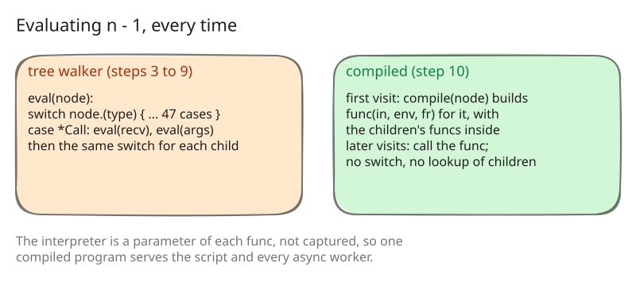

# 10. Each node compiles to a closure on first use

Steps 8 and 9 took the allocations out of a call. What remained of the
evaluator's own cost was the evaluator: every visit to a node went through
one type switch of 47 cases ([src/eval/eval.go:23](https://github.com/radiospiel/amber/blob/@@COMMIT@@/src/eval/eval.go#L23)),
and a call's receiver and arguments each went through it again.

## Compiling to closures

`compile.go` turns a node into a Go function, a thunk, the first time the
node is evaluated, and keeps it
([src/eval/compile.go:14](https://github.com/radiospiel/amber/blob/@@COMMIT@@/src/eval/compile.go#L14-L27)). The hot
kinds compile with their children inline: literals, variables, fields,
constants, calls with the operator fast path of step 9, blocks, control
flow and `begin`/`rescue`. A call to `n - 1` becomes a function that calls
the thunk of `n`, checks for two integers and subtracts; no switch runs and
no child is looked up. The rare kinds compile to a call into the tree
walker, whose children come back through the same cache, so the two
evaluators coexist and each node kind can move over when it is worth it.

This is the technique of closure compilation, a middle way between a tree
walker and a bytecode virtual machine: Marc Feeley and Guy Lapalme
described it in [Using closures for code generation](https://ftp.math.utah.edu/pub/tex/bib/idx/complngs/12/1/47_66.html) (Computer Languages 12(1), 1987).
It keeps amber's tree as the program, needs no instruction set, and lets
Go's compiler optimise each thunk.

The interpreter is a parameter of every thunk, not a variable it captures.
One compiled program therefore serves the script's interpreter and every
`async` worker of step 7 without sharing their state, and the cache is a
`sync.Map`, safe for the workers to fill concurrently.

`/` and `%` on integers join the operator fast path in this step, with
Ruby's floor semantics: `-7 / 2` is `-4`, `-7 % 2` is `1`. A zero divisor
takes the ordinary path, which raises `ZeroDivisionError` as before.

## What it bought

In-process, through the `amber` package:

| | fib | loop | strings |
|---|---|---|---|
| step 9 | 0.57 s | 1.85 s | 0.30 s |
| step 10 | 0.47 s | 0.82 s | 0.24 s |

The arithmetic loop gains most: it is all small nodes, where the switch
was most of the work. Its allocations, 12 M for 3 M iterations, are the
integers it computes, which step 11 addresses.
