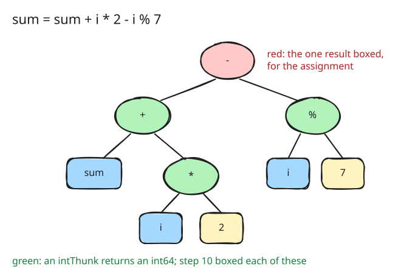

# 11. Integer intermediates stay unboxed

After step 10 the arithmetic loop of the history benchmarks still made four
allocations per iteration: one for every integer an operator computed
outside the small-integer table of step 9. In `sum = sum + i * 2 - i % 7`
and `i += 1`, that is `i * 2`, the sum, the difference and `i + 1`, and
the first two of them were thrown away by the next operator.

## A tree of unboxed results

An arithmetic expression over integers now compiles to a tree of
`intThunk`s ([src/eval/compile.go:449](https://github.com/radiospiel/amber/blob/7931e0d7ee41f94fb90f86cf3b7fb80916003751/src/eval/compile.go#L449-L457)). An
`intThunk` returns its result as a plain `int64` when it is an integer,
and boxed only when it is anything else. An operator node asks its operands
for integers, computes, and passes an `int64` up; only the root of the tree
boxes its result, because the assignment needs a value. A comparison reads
its operands the same way, so `i < 3_000_000` boxes nothing at all.

An operand that is not an integer boxes what it has and takes the ordinary
path, so the semantics are those of the boxed fast path and of dispatch:
`1 + 1.5` and `1 + "a"` behave as before. The boxed fast path leaves
`evalCall`, which the compiler no longer reaches for operator calls.

At this step integers are 64-bit, and the arithmetic wraps on overflow as
Go's does. Step 25 makes integers arbitrary-precision, and the unboxed
paths then check for overflow and hand that case to the ordinary call.

## What it bought

In-process, the arithmetic loop:

| | time | allocations | bytes |
|---|---|---|---|
| step 10 | 0.82 s | 12.0 M | 96 MB |
| step 11 | 0.74 s | 6.0 M | 48 MB |

Half the allocations went, a tenth of the time. The remaining 6 M are the
two results per iteration that are assigned, `sum` and `i`; a Value that
holds an integer without a heap box is the next step.

The same step replaces "answers" with "returns" throughout the comments,
and "yields" where a safe call returns `nil`: a function returns a value,
and `yield` is a keyword.
