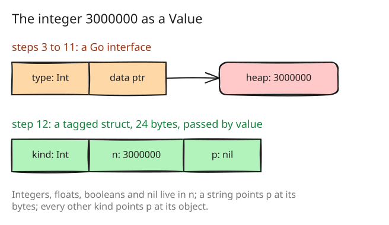

# 12. A Value is a tagged struct

Steps 9 and 11 worked around one fact: a Go interface that holds an integer
points at a heap copy of it. The small-integer table avoided the copy for
small results and the unboxed thunks avoided it for intermediate ones, but
every integer that was stored, in a variable, an array or a field, still
cost an allocation. Step 12 changes what a value is.

## Three words, passed by value

`object.Value` becomes a 24-byte struct of a kind, an integer payload and
a pointer ([src/object/value.go:90](https://github.com/radiospiel/amber/blob/@@COMMIT@@/src/object/value.go#L90-L95)). An integer, a
float, a boolean and `nil` live entirely in the payload and never touch the
heap. A string or a symbol points at its bytes. Every other kind points at
its object; a Proc and a process are opaque pointers that the evaluator
wraps, since their types belong to the `eval` package.

This is the representation dynamic-language runtimes have used for
decades, a tagged union; the variant here spends a whole word on the tag
instead of packing it into the pointer, because Go's garbage collector
must see every pointer for what it is.

The zero Value is "no value", which takes over the job a Go `nil`
interface did: an absent default, an unset field, a missing range bound.
amber's `nil` is a kind of its own (`KindNil`). The struct is not
comparable with `==`, since two equal strings may point at different bytes,
so `Equal`, `Same`, `IsNil` and `IsZero` replace `==`, and a zero-size
`func` field makes the compiler reject any `==` left behind.

## The change everywhere else

Constructors keep their names and return a Value; `ListValue`, `MapValue`
and the like wrap objects; readers come checked (`AsInt`, `AsList`, with an
`ok`) and unchecked (`Int`, `List`). Every type switch over values in the
evaluator and the library became a switch on `Kind`, every type assertion a
reader. It is the largest diff of the history after the first steps,
1 873 lines in and 1 393 out, and it changed no behaviour: the examples
pass unchanged.

The small-integer table of step 9 goes, since there is nothing left to
pre-box. A scope keeps four variables inline instead of six: a Value is
larger than an interface, and six of them made each activation cost more
in the collector than the map they avoid.

## What it bought

In-process, through the `amber` package:

| | loop | | block | strings |
|---|---|---|---|---|
| | time | allocations | time | time |
| step 11 | 0.74 s | 6 000 082 | 0.91 s | 0.25 s |
| step 12 | 0.42 s | 1 132 | 0.62 s | 0.19 s |

The arithmetic loop no longer allocates per iteration at all; what remains
is loading the script. `fib(27)` stays where it was, 0.44 s against
0.48 s: its 1.27 M allocations are frames and scopes, not integers.
