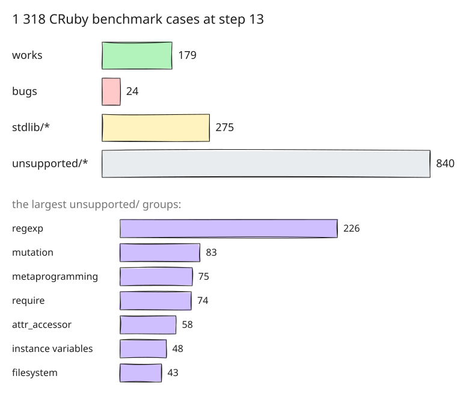

# 13. CRuby's benchmark suite, sorted by what amber lacks

Steps 1 to 12 built the language the design describes and made it fast on
the history benchmarks. Neither says how much real Ruby amber runs. Step 13
imports a large body of real Ruby, [CRuby's own benchmark
suite](https://github.com/ruby/ruby/tree/master/benchmark), and sorts every
case by what amber does with it. Most of the steps after this one are
driven by that sorting.

## One script per case

[benchmarks/ruby/](../../benchmarks/ruby) holds the cases of CRuby's
`benchmark/` directory at one commit, one runnable script each. A `.rb`
benchmark is copied as it is. A `.yml` benchmark definition, which
[benchmark-driver](https://github.com/benchmark-driver/benchmark-driver)
runs, becomes one file per entry: the definition's prelude followed by the
entry's body, run once. The 24 `so_*` shootout programs are left out, since
CRuby's `LEGAL` file calls their legal situation unclear; everything
imported comes with Ruby's license files.

## Sorted by the first thing that stops it

Every case ran under `amber check`, under CRuby 3.3.6 and under amber, and
went into one of four directories:

| Directory | Holds |
|---|---|
| `works/` | runs under amber with Ruby's result |
| `bugs/` | should run, and fails on a defect in amber |
| `stdlib/<what>/` | stops on a builtin amber is to have and does not yet |
| `unsupported/<what>/` | uses something amber leaves out by design |

Most benchmarks print nothing, so a clean exit proves little: every case
that ran cleanly ran again printing its value. A case is filed under the
first thing that stops it, and `MANIFEST.tsv` gives each its source and its
reason. `run.rb` runs a directory, exits 1 when a `works/` case fails, and
lists the cases elsewhere that now run cleanly.

At this step 179 cases work. The 24 in `bugs/` are five defects, the
largest that `Object` is not bound as a constant (15 cases), and one that
matters later: building a hash with `h[k] = v` copies the whole hash each
time, so it is quadratic and four cases time out. The history benchmark
`hash.arb` shows the same, 48 s against MRI's 0.12 s.

## What the sorting decided

The `stdlib/` directories became a list of decisions, taken one by one:
which builtins amber is to have and how. `Array.new`, a seedable `Random`,
`String#succ` with Ruby's rules, `Time` with offsets, `Hash.new` with a
default, and a set of small methods were taken in; they are steps 14 to 19.
`Struct`, `Rational` and `Complex`, and `RUBY_VERSION` were left out, and
their 24 cases moved to `unsupported/struct`, `unsupported/complex` and
`unsupported/ruby-version`, so `stdlib/` holds only what is planned. The
design document records each decision with its reason.

The `unsupported/` directories are the larger question, and a second round
of decisions, over the language rather than the library, followed: the
largest groups are regular expressions (226 cases), mutation (83),
metaprogramming (75) and `require` (74). Steps 20 to 30 take several of
them in.

In this repository's replay, two of the cases filed under `stdlib/hash`
already run here, since lists and hashes have carried Ruby's names since
step 1; step 14 moves them to `works/`.
