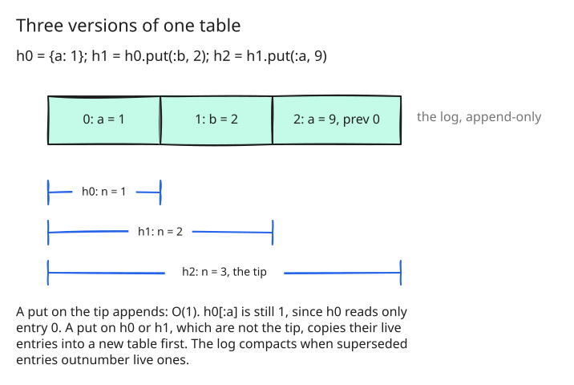

# 20. Linear maps, and the benchmark bugs fixed

Step 13 found 24 cases in `bugs/`, and one of the five defects behind them
was structural: building a hash key by key, `h[k] = v` in a loop, copied
the whole hash every time. A hash is immutable, so `h[k] = v` rebinds `h`
to a copy with one more key, and the copy cost the size of the hash. Twenty
thousand keys meant two hundred million entries copied:

| | hash.arb, 20 000 keys | allocated |
|---|---|---|
| MRI | 0.12 s | |
| step 19 | 49.7 s | 19.1 GB |
| step 20 | 0.06 s | 11.8 MB |

## Versions of an append-only table

The usual answer for an immutable map is a persistent tree, such as the
hash array mapped trie of Phil Bagwell's
[Ideal Hash Trees](https://lampwww.epfl.ch/papers/idealhashtrees.pdf)
that Clojure and Scala use, where a copy with one more key shares all but
a path of the old tree. amber takes a simpler route that fits how scripts
use hashes: the old version is almost never touched again once a new one
exists.

A hash or a set is a version of a table: an append-only log of entries and
an index from each key to its latest entry, and the version is the first
`n` entries of the log ([src/object/table.go:8](https://github.com/radiospiel/amber/blob/@@COMMIT@@/src/object/table.go#L8-L24)).
The version at the log's tip grows the table in place, so a `put` on it
appends one entry, O(1). Any other version copies its live entries into a
new table first, so an old version is never disturbed. An entry below a
version's length never changes, which is what keeps every version
immutable however the table grows. The log compacts when superseded
entries outnumber live ones.

A constant's hash can be read by several `async` processes at once, so the
log and the index grow under the table's lock; reads take the read lock.

## The other bugs

- `Object` is bound as a constant, and a bare `Object` prints `#<Object>`
  (15 cases).
- `defined?(expr)` returns Ruby's words, `"local-variable"`, `"method"`,
  `"constant"` and the rest, without evaluating what it names.
- `Range#reverse_each` returns the receiver, `Integer#infinite?` is `nil`,
  and `Array#values_at` takes a range's elements, `nil` past the end.

Every case under `bugs/` is re-filed: 18 move to `works/`, and the rest to
what they turned out to need: object identity, amber's `tap`, `GC`, a
stateful `Random`.

## The second round of decisions

With the library in place, the design records a second round of decisions,
this time over the language: what of `unsupported/` amber takes in. The
largest are that a mutating call on a local rebinds it (step 22), regular
expressions (step 24), integers of any size (step 25), lazy enumerators
(step 26) and `require` of built-in libraries (step 27). Steps 21 to 30
work through them.
