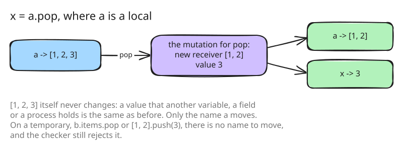

# 22. A mutating call on a local rebinds it

The largest language decision of the second round. Ruby code is full of
`list << x`, `h.delete(k)`, `a.pop` and `s.upcase!`, and the checker of
step 2 rejected every one. 83 benchmark cases sat in
`unsupported/mutation`.

The insight is the one `h[k] = v` already used (step 2): when the receiver
is a local variable, a mutating call can mean "rebind the variable to the
changed copy". Nothing that another variable, a field or a process holds
can change, because the value itself does not; only the name moves.



## What the call returns

The call's value is Ruby's, so code that uses it keeps working: `<<` and
`push` return the receiver, the new copy; `pop`, `shift` and `delete`
return the removed element; a bang method returns `nil` when it changed
nothing, as `compact!` and `uniq!` do in Ruby. Each method's mutation is a
small function from the current value to the new receiver and the value
to return ([src/eval/mutate.go:101](https://github.com/radiospiel/amber/blob/@@COMMIT@@/src/eval/mutate.go#L101-L118)).

Whether a call mutates depends on the receiver's kind, which only the
evaluator knows: `delete` on an Array removes an element, and on a String
it is a different method. So the checker accepts a possibly mutating call
on a local ([src/syntax/convert.go:1128](https://github.com/radiospiel/amber/blob/@@COMMIT@@/src/syntax/convert.go#L1128)), and the
evaluator decides when it runs.

## Where it does not apply

On any other receiver the call is still rejected, with the method to use
instead:

```
b.items.pop   # pop changes its receiver, which amber rebinds only for a local
              # variable or a field in initialize; use last and take
```

A field inside `initialize` counts as a local, since `@x = v` there sets a
field. A mutating call on a temporary, `[1, 2].push(3)`, has no name to
rebind, and its result would be dropped; the design records that it stays
rejected, since the non-mutating form, `+` here, says what is meant.

[examples/mutation.arb](../../examples/mutation.arb) covers the methods and
their values. Along the way `Hash#shift` becomes O(1), `Integer#<<`
exists, and `Hash#merge` takes keywords. Seven benchmark cases move to
`works/`; most of the 83 stop next on something else.
