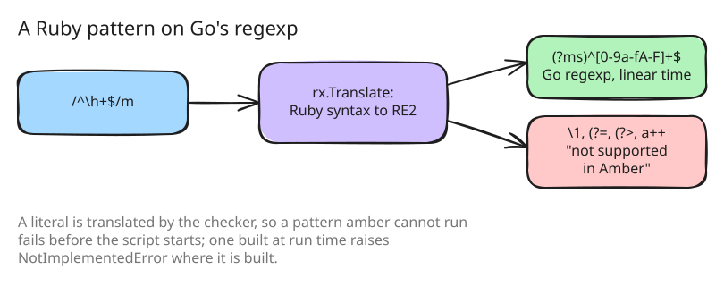

# 24. `Regexp` and `MatchData` on Go's regexp

226 benchmark cases, the largest group of `unsupported/`, used regular
expressions, which step 2 rejected outright. Ruby's regular expressions are
[Onigmo](https://github.com/k-takata/Onigmo)'s, a backtracking engine with
backreferences, lookaround, atomic groups and possessive quantifiers. Go's
standard [`regexp`](https://pkg.go.dev/regexp) is
[RE2](https://github.com/google/re2/wiki/Syntax), which has none of those
and in exchange matches in time linear in the input.

## The choice of engine

Two engines were candidates. A Go port of Onigmo,
[go-ruby-regexp](https://github.com/go-ruby-regexp/regexp), would run
Ruby's patterns as Ruby does. Its `go.mod`, and that of the engine it
builds on, require Go 1.27, while amber builds with Go 1.26.4; vendoring it
with the requirement lowered would have made amber the maintainer of a
regular-expression engine. It was set aside, and amber uses Go's `regexp`,
accepting that a pattern which needs backtracking does not run.

That limit has a second side. A backtracking engine can take time
exponential in the input on a pattern like `/^(a|aa)+$/`, the problem
known as [ReDoS](https://owasp.org/www-community/attacks/Regular_expression_Denial_of_Service_-_ReDoS),
which Ruby 3.2 addressed with a match cache and `Regexp.timeout`. For a
language whose scripts a host program runs on behalf of its users, a
regular expression that cannot run away is a property worth having;
Russ Cox's [Regular Expression Matching Can Be Simple And Fast](https://swtch.com/~rsc/regexp/regexp1.html)
explains why RE2's approach guarantees it.

## Ruby's syntax, translated

The `rx` package translates a Ruby pattern into Go's syntax
([src/rx/rx.go:39](https://github.com/radiospiel/amber/blob/@@COMMIT@@/src/rx/rx.go#L39-L55)). `^` and `$` match at every line
in Ruby, so the translation is always multi-line; Ruby's `m` is Go's `s`;
`x` drops whitespace and comments; and `\h`, `{,n}`, `\e`, `\u{…}`, `\xHH`
sequences and Ruby's property names become what Go understands. A plain
group beside named ones does not capture, as in Ruby.



A pattern that needs backtracking is refused by name: a backreference,
lookahead or lookbehind, an atomic group, a possessive quantifier, a
subexpression call, `\G`, `\K`, `\Z`, class intersection
([src/rx/rx.go:29](https://github.com/radiospiel/amber/blob/@@COMMIT@@/src/rx/rx.go#L29-L31)):

```
This regexp is not supported in Amber: /(a)\1/ uses a backreference
```

A literal is translated by the checker, so such a script fails before it
starts; a pattern built at run time raises `NotImplementedError` where it
is built.

## Values, not globals

A `Regexp` is an immutable value of its source and options, and a literal
without interpolation compiles once. Every String method that takes a
pattern takes a string or a regexp. Ruby's `$~`, `$1` and the other match
globals do not exist, since amber has no globals: a match is what `match`
returns, or a block's argument, `str.scan(re) { |m| … }`. A regexp travels
in the envelope as its source and options.

`unsupported/regexp` is empty after this step: every one of its 226 cases
either runs or stops on something else, and none of the cases in `works/`
needs backtracking. `Set` gains `^`, `<=>`, `join`, `flatten`, `classify`
and `divide`, which the Set benchmarks needed once they could run.
