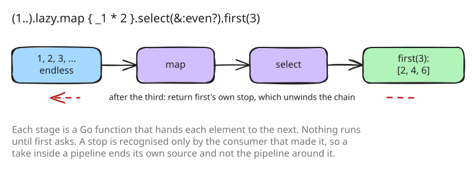

# 26. Lazy enumerators

Step 4 made every Enumerable method collect its receiver's elements into a
slice first, and a method without a block return an array. That leaves
out an idiom Ruby code uses for endless and expensive sequences:
`(1..).lazy.map { … }.select { … }.first(3)`, which only works if nothing
runs until `first` asks, and stops as soon as it has three.

## An enumerator is a Go function

An Enumerator produces its elements on demand: it holds a Go function that
hands each element to a consumer, one at a time
([src/object/enumerator.go:11](https://github.com/radiospiel/amber/blob/cf7f1e7062ee75a0e718de9a710e334a761eec6b/src/object/enumerator.go#L11-L19)). A lazy
method, `map`, `select`, `take`, `zip`, `flat_map` and the rest, makes a
new Enumerator whose function runs the old one's and transforms what it is
given. Nothing runs until `first`, `to_a`, `force` or `each` asks.

A consumer that has had enough returns a stop from the function it was
given, which unwinds the source. The stop is the consumer's own: each makes
a new one and recognises only that one
([src/stdlib/enumerator.go:22](https://github.com/radiospiel/amber/blob/cf7f1e7062ee75a0e718de9a710e334a761eec6b/src/stdlib/enumerator.go#L22-L25)).
That is what lets `take` end an endless source inside a pipeline without
ending the pipeline it is nested in: `(1..).lazy.map { (1..).lazy.take(_1).sum }.first(3)`
stops each inner range after its elements and the outer one after three.

A blockless `cycle`, `then` or `yield_self` gives an eager Enumerator,
whose `first`, `take`, `find` and `include?` stop early too. There is no
external iteration (`next`, `peek`), which would need a producer to pause
between two elements and resume later.

[examples/lazy.arb](../../examples/lazy.arb) has the forms, with ruby's
output as the expected output. The 15 enumerator cases of the benchmark
suite move to `works/`, which holds 710.
