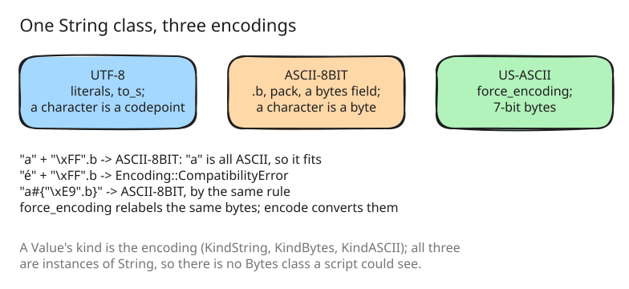

# 30. Strings carry their encoding, and `Array#pack`

Until this step a String was UTF-8 text, and binary data was a `Bytes`
value of its own, the value of a protobuf `bytes` field (step 6). Ruby has
no `Bytes` class: a String carries an encoding, and binary data is a
String whose encoding is ASCII-8BIT. 18 benchmark cases stopped on
encodings, and every `.b`, `pack` and `unpack` in the suite assumed Ruby's
model.

amber supports the three encodings scripts meet in practice, UTF-8,
ASCII-8BIT (binary) and US-ASCII, and no others.

## One class, three kinds

A String's encoding is the kind of its Value: `KindString` is UTF-8,
`KindBytes` binary and `KindASCII` US-ASCII
([src/object/value.go:30](https://github.com/radiospiel/amber/blob/@@COMMIT@@/src/object/value.go#L30-L33)),
and all three are instances of `String`. The separate `Bytes` class is
gone, so `"\xFF".b.class` is `String`, as in Ruby.

Literals are UTF-8. `.b`, `pack` and a protobuf `bytes` field make binary
strings. A binary or US-ASCII string has one character per byte, changes
case in ASCII alone, prints a byte past 7 bits as `\xNN`, and gives the
results of its methods its encoding.

## Combining strings

`+`, `<<`, `join` and interpolation take the encoding their parts are
compatible in, by Ruby's rule: a string that is all ASCII fits any of the
three, so `"a" + "\xFF".b` is binary; two strings with non-ASCII bytes in
different encodings raise `Encoding::CompatibilityError`
([src/stdlib/encoding.go:79](https://github.com/radiospiel/amber/blob/@@COMMIT@@/src/stdlib/encoding.go#L79-L94)). `force_encoding`
relabels the same bytes, and on a local it rebinds the local, as Ruby's
changes its receiver (step 22); `encode` converts them, with `invalid:`,
`undef:` and `replace:`. `valid_encoding?` and `scrub` deal with bytes an
encoding does not allow, and `Integer#chr` picks the encoding of its byte.

The one difference a script can see: `Integer#to_s` and `Symbol#to_s` give
UTF-8 where Ruby gives US-ASCII; only `encoding` tells them apart.

## Pack and unpack

`Array#pack` and `String#unpack` and `#unpack1` cover the integer, float,
UTF-8, string, hex and base64 directives, which is what the benchmarks use.
Their results are binary strings, and `Regexp.union` of binary strings
matches bytes.

[examples/encodings.arb](../../examples/encodings.arb) and
[examples/string_encodings.arb](../../examples/string_encodings.arb) hold the
cases, with ruby's output as their expected output. `unsupported/encodings`
is empty, and `works/` holds 823.

## In one step

ark took two steps for this, and the first was a detour: it kept the
separate `Bytes` class and taught it more of String's methods, then
replaced it with encodings on String a few hours later, once it was decided that
amber supports exactly UTF-8, binary and US-ASCII. This repository takes
the second design directly; the history of ark has both.
