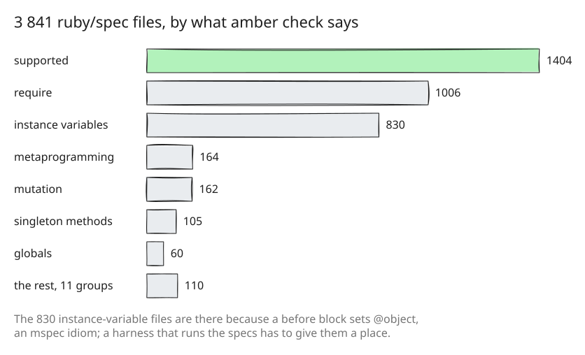

# 34. ruby/spec, sorted by what the checker accepts

CRuby's benchmarks (step 13) measure how much of the Ruby that people run
amber can run. [ruby/spec](https://github.com/ruby/spec) measures something
else: the specification of the Ruby language and its core library, one
spec file per method, written for any Ruby implementation, which is how
JRuby and TruffleRuby test their compatibility. This step brings all of it
into [specs/](../../specs), sorted, and runs none of it.

## Sorted by the checker alone

[specs/sort.rb](../../specs/sort.rb) runs `amber check` on each of the
3 841 `*_spec.rb` files and files it under the first thing that stops it
([specs/sort.rb:50](https://github.com/radiospiel/amber/blob/@@COMMIT@@/specs/sort.rb#L50)):

- a `require` of a library amber does not build in goes to
  `unsupported/require`;
- a parse error goes to `bug/` when `ruby -c` accepts the file, since then
  amber's parser is wrong, and to `unsupported/newer-syntax` when MRI
  rejects it too;
- otherwise the checker's first message names the directory.

The `require_relative` lines that load mspec's `spec_helper` and a spec's
fixtures are the harness's business, so they do not count against a file.
Each directory mirrors ruby/spec's tree and holds the support files its
specs load, so a spec keeps its path and could run where it is.

## What the sorting says

1 404 files, 37%, pass the checker. One is a parser bug. The largest
blockers are not the language: 1 006 files require a library amber does
not build in, and the 830 under `unsupported/instance-variables` are there
because of an idiom of [mspec](https://github.com/ruby/mspec), ruby/spec's
harness, a `before` block that sets `@object` for the examples to read.
A harness that runs ruby/spec on amber will have to give those blocks
somewhere to keep their state, which is a question for the harness rather
than for the language.

Running them is the next piece of work, and deliberately not this step's:
a sorted, checked-in copy is what that work starts from. ruby/spec is
under the MIT license; a copy of it is at the root of each directory.
