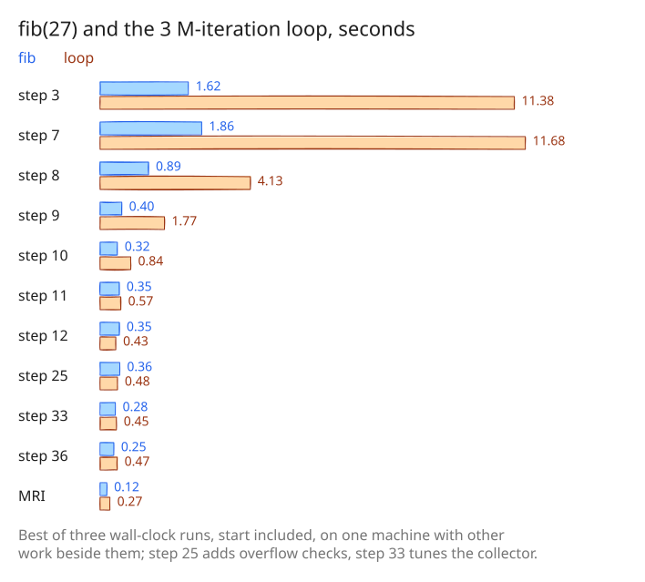

# 36. amber against MRI, go-embedded-ruby and a WASM CRuby

The last step of the history asks the question a Go program choosing an
embedded Ruby would ask: how does amber compare with the alternatives? It
adds the commands and the script to measure that, and the results of one
full run over the 824 cases of `benchmarks/ruby/works`.

## Four Rubies

| Ruby | What it is |
|---|---|
| `mri` | the `ruby` on `PATH`, CRuby 3.3.6 for these results |
| `amber` | this repository's interpreter |
| `warmruby` | CRuby 3.4 compiled to WASI, run on [wazero](https://wazero.io/) in a VM started ahead, as ark's agentic embeds it |
| `rbgo` | [go-embedded-ruby](https://github.com/go-embedded-ruby/ruby) v0.6.0, a Ruby interpreter in Go |

[benchmarks/rbgo/](../../benchmarks/rbgo) is a command that runs a script
on go-embedded-ruby. It needs Go 1.27.2, so it is a module of its own,
built with `GOWORK=off GOTOOLCHAIN=auto`, and amber stays on Go 1.26.4.
The warmruby command links agentic, a module of ark under the AGPL, so it
stays in ark; the results below were measured there with all four, and in
this repository `compare.rb` runs the other three.

## Measuring without the start

[benchmarks/compare/compare.rb](../../benchmarks/compare/compare.rb) first
measures each Ruby's start, the median time of an empty script:

| mri | amber | warmruby | rbgo |
|---|---|---|---|
| 0.107 s | 0.008 s | 1.789 s | 0.131 s |

A first run that timed whole processes made amber look five times faster
than MRI, because most cases run for a few milliseconds and amber starts in
a tenth of MRI's time. So each case runs again and again until its runs add
up to a second ([benchmarks/compare/compare.rb:185](https://github.com/radiospiel/amber/blob/15c2dfb65559dee49bbd842615bc24cd26ca1b48/benchmarks/compare/compare.rb#L185-L198)), and
its time is the mean run less the start; warmruby and rbgo report the
script's own time, which is used for them instead. Each output is checked
against CRuby 3.4's.

## The results

| | mri | amber | warmruby | rbgo |
|---|---|---|---|---|
| ran cleanly | 783 | **824** | 789 | 785 |
| output differs from CRuby 3.4 | 7 | 0 | 0 | 0 |
| total seconds | **303** | 671 | 1994 | 1459 |
| geometric mean of time vs mri | **100%** | 104% | 780% | 660% |
| fastest | **458** | 384 | 6 | 0 |

On the typical case amber and MRI are close, and amber is faster in 324 of
the 783 cases both run, most of them short. On the 71 cases MRI takes half
a second or more, amber takes 234% of MRI's time, warmruby 1739% and rbgo
498%. Among the embeddable Rubies amber is the fastest by a wide margin;
against MRI it is within a small factor. [results.tsv](../../benchmarks/compare/results.tsv) has every case,
and `ruby compare.rb --report results.tsv` shows them as a coloured table.

amber is slowest against MRI on sorts that dispatch `<=>` per comparison
(`array_sort_float` 17×), small hash literals built in a loop
(`hash_literal_small8` 16×), `Hash#shift` in a loop (12×), and method calls
in deep recursion (`app_tak` 14×, `app_fib` 11×).
[hotspots.rb](../../benchmarks/compare/hotspots.rb) runs those cases alone,
which is where the work after this history starts.

## The history in numbers

The history benchmarks of step 8, on the binaries of the steps that
changed them:

From step 3 to step 36, `fib(27)` went from 1.62 s to 0.25 s and the
arithmetic loop from 11.4 s to 0.47 s, a factor of 6 and of 24, while the
language grew from the design's subset to 824 of CRuby's own benchmarks.
Building a hash key by key went from quadratic to linear in step 20, from
48 s at step 5 to 0.03 s. MRI is still about twice as fast on both, and
the next steps are in `hotspots.rb`.
